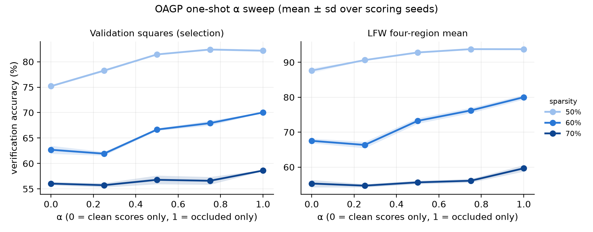

# OAGP fusion weight α (E6)

OAGP scores each weight as `(1 − α) · clean + α · occluded`, after dividing each condition's Taylor score by its layer
mean. α = 0 uses only the clean half of the calibration set and α = 1 only the occluded half. **Accuracy rose with α,
and validation selected α = 0.75 at 50% sparsity and α = 1 at 60% and 70%.** On LFW the selected settings gave
93.77%, 80.02% and 59.66% (four-region mean), compared with 92.82%, 73.25% and 55.63% for the default α = 0.5. In this
setup, mixing clean scores into the occluded ones did not help one-shot pruning, matching the
[one-shot grid](../oneshot_grid/README.md), where Occ-Taylor ≈ OAGP-max > OAGP.

| α | Validation squares 50% | 60% | 70% | LFW regions 50% | 60% | 70% |
| ---: | ---: | ---: | ---: | ---: | ---: | ---: |
| 0 | 75.19 | 62.70 | 56.04 | 87.64 | 67.52 | 55.29 |
| 0.25 | 78.25 | 61.93 | 55.73 | 90.64 | 66.35 | 54.69 |
| 0.5 | 81.44 | 66.67 | 56.79 | 92.82 | 73.25 | 55.63 |
| 0.75 | **82.40** | 67.93 | 56.60 | **93.77** | 76.21 | 56.09 |
| 1 | 82.18 | **70.03** | **58.61** | 93.75 | **80.02** | **59.66** |

Mean accuracy (%) over scoring seeds 42–44, one-shot. "Validation squares" is the mean of square 10/30/50% on the
held-out CASIA pairs and is the selection criterion; LFW is reported only. Standard deviations and validation clean accuracy
are in [alpha_sweep.md](alpha_sweep.md), and every value is in [alpha_sweep.csv](alpha_sweep.csv). The α = 0.5 row reuses the
OAGP runs of the one-shot grid.



## Reading the result

- α = 1 uses 512 occluded photos and matches Occ-Taylor, which uses 1,024 (93.75 vs 93.73% at 50%, 80.02 vs 79.25% at 60%).
  Half the occluded calibration set gave about the same ranking as all of it.
- The curve is not monotone at 60–70% for small α (α = 0.25 is slightly below α = 0). Differences there are within about
  1 pp and most models are near chance on occluded pairs.
- These are one-shot results. After fine-tuning, methods differ by less than 0.3 pp ([fine-tuning grid](../finetune_grid/README.md)),
  so α was not swept with fine-tuning.

## Reproduce

```bash
python -m occprune.prune_run --checkpoint checkpoints/dense_aug_seed42.pt --methods oagp --alpha 0.75 \
    --output results/pruning/runs/alpha0.75_score42 --sparsity 0.5 0.6 0.7 --scoring-seed 42 --test-set lfw
```

```python
import glob
from occprune.prune_report import write_alpha_report
runs = sorted(glob.glob("results/pruning/runs/alpha*_score*")) + sorted(glob.glob("results/pruning/runs/oneshot_grid_score*"))
write_alpha_report(runs, "results/pruning/alpha_sweep")
```
