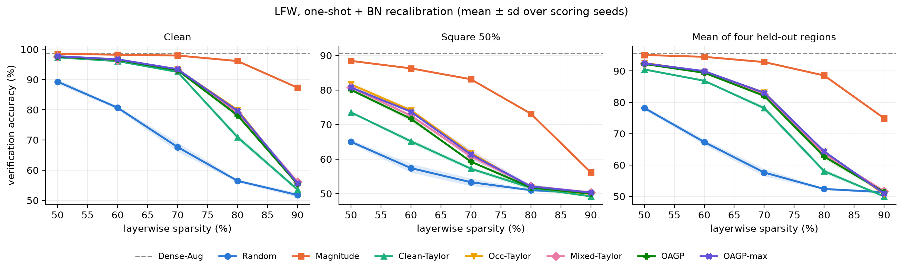
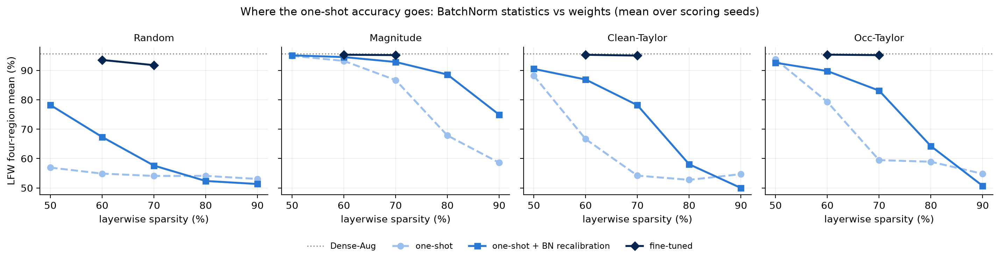

# One-shot pruning + BatchNorm recalibration (E3b)

Pruning removes weights but leaves every BatchNorm layer normalising with the **dense** model's running mean and variance.
Here each pruned model is evaluated a second time after re-estimating those statistics on 2,048 CASIA training photos
(forward passes only, no weight update, about 0.2 s). **This recovered about two-thirds of the gap between one-shot and
fine-tuned accuracy for every scoring-based method at 60–70% sparsity**, so much of the one-shot "collapse" of the gradient
methods was stale BatchNorm statistics, not lost weights. It did not change the ranking: **Magnitude still led at every
sparsity** (by 2.7–23.7 pp), and **Occ-Taylor still beat Clean-Taylor** (+2.8 / +3.5 / +4.3 / +6.3 pp at 50–80%, CI above zero
in 21–24 of 24 cells each).

## Four-region LFW mean (%), mean over scoring seeds 42–44

| Method | 50% | 60% | 70% | 80% | 90% |
| --- | ---: | ---: | ---: | ---: | ---: |
| Dense-Aug (unpruned) | 95.66 | | | | |
| Dense-Aug + BN recalibration (control) | 95.60 | | | | |
| Random | 78.21 | 67.33 | 57.61 | 52.37 | 51.34 |
| Magnitude | **95.10** | **94.51** | **92.84** | **88.57** | **74.91** |
| Clean-Taylor | 90.49 | 86.88 | 78.15 | 58.04 | 49.98 |
| Occ-Taylor | 92.58 | 89.76 | 83.10 | 64.23 | 50.71 |
| Mixed-Taylor | 92.31 | 89.62 | 82.45 | 63.57 | 51.67 |
| OAGP (α = 0.5) | 92.23 | 89.43 | 82.08 | 62.72 | 51.35 |
| OAGP-max | 92.44 | 89.96 | 83.07 | 64.34 | 50.90 |

All after BN recalibration. Every condition with seed standard deviations is in
[summary_lfw_bn_recal.md](summary_lfw_bn_recal.md), and held-out CASIA pairs are in
[summary_validation_bn_recal.md](summary_validation_bn_recal.md). The Dense-Aug row in those files is the unrecalibrated model;
the control above comes from `dense_bn_recal` in each `result.json`. The one-shot files in this folder reproduce the
[one-shot grid](../oneshot_grid/README.md) exactly: all 1,260 one-shot accuracies are identical.



## One-shot → BN recalibration → fine-tuned

[stage_comparison.md](stage_comparison.md) lists all seven methods. "Gap closed" is
(BN-recalibrated − one-shot) / (fine-tuned − one-shot), using the [fine-tuning grid](../finetune_grid/README.md) at 60 and 70%.

| Method | 60% one-shot | + BN | fine-tuned | gap closed | 70% one-shot | + BN | fine-tuned | gap closed |
| --- | ---: | ---: | ---: | ---: | ---: | ---: | ---: | ---: |
| Random | 54.87 | 67.33 | 93.53 | 32% | 54.08 | 57.61 | 91.77 | 9% |
| Magnitude | 93.21 | 94.51 | 95.31 | 62% | 86.68 | 92.84 | 95.18 | 72% |
| Clean-Taylor | 66.63 | 86.88 | 95.29 | 71% | 54.19 | 78.15 | 95.02 | 59% |
| Occ-Taylor | 79.25 | 89.76 | 95.33 | 65% | 59.47 | 83.10 | 95.18 | 66% |
| OAGP | 73.25 | 89.43 | 95.42 | 73% | 55.63 | 82.08 | 95.16 | 67% |
| OAGP-max | 78.79 | 89.96 | 95.39 | 67% | 56.44 | 83.07 | 95.17 | 69% |



## Paired contrasts after BN recalibration (B − A, pp; cells with CI > 0 / < 0 out of 24)

| A → B | 50% | 60% | 70% | 80% | 90% |
| --- | --- | --- | --- | --- | --- |
| Clean-Taylor → Occ-Taylor | +2.79 (22+) | +3.53 (23+) | +4.26 (24+) | +6.29 (21+) | +0.87 (9+) |
| OAGP → OAGP-max | +0.25 (10+) | +0.67 (12+) | +1.18 (17+) | +1.68 (17+, 1−) | −0.15 (2+, 3−) |
| Magnitude → OAGP-max | −2.86 (24−) | −4.96 (24−) | −10.41 (24−) | −22.66 (24−) | −23.58 (24−) |
| Magnitude → Occ-Taylor | −2.66 (24−) | −5.05 (24−) | −10.39 (24−) | −22.68 (24−) | −23.74 (24−) |

Mean over the 3 seeds × 8 LFW conditions. Per-pair CIs for both stages are in [bootstrap_lfw.csv](bootstrap_lfw.csv).

## Reading the result

- **BN shift explains most of the Taylor collapse, not all of it.** At 70%, recalibration lifted Occ-Taylor from 59.5 to 83.1%
  and Clean-Taylor from 54.2 to 78.2%, but both stay 10–15 pp below Magnitude (92.8%). Even with BatchNorm statistics fixed,
  gradient-chosen masks keep a worse set of weights for zero-shot use. The rest of the gap closes only with fine-tuning.
- **Magnitude gains most at high sparsity** (+20.7 pp at 80%, +16.3 pp at 90%), so its one-shot lead was not a BatchNorm
  artefact either. The gap to the gradient methods widened at 80–90%.
- **Occluded calibration still helps.** The Occ-Taylor advantage over Clean-Taylor shrank at 50–60% (from +6.2 / +11.5 pp
  to +2.8 / +3.5 pp) but held or grew at 70–80%. Part of the earlier gap was a BatchNorm effect, and part reflects which
  weights the occluded scores keep.
- **At 50% recalibration slightly hurt the occluded-score methods** (Occ-Taylor 93.73 → 92.58, OAGP-max 93.76 → 92.44),
  while Clean-Taylor and Magnitude improved. At 90% the gradient methods fell from about 54% to about 51%, which is near
  chance either way. Recalibration is therefore not a free improvement at every operating point.
- **The control is clean.** Recalibrating the unpruned model changed the four-region mean by −0.06 pp, so the procedure itself
  does not move accuracy. Random gains at 50–60% but stays far below the other methods, as expected when most of the
  remaining weights are uninformative.

## Setup and reproduction

- Same checkpoint, calibration banks, masks and evaluation as the [one-shot grid](../oneshot_grid/README.md).
- Recalibration: reset every BatchNorm's running statistics, set momentum to `None` (exact cumulative average), and forward
  2,048 training photos in train mode with no gradients. Inputs follow the Dense-Aug training distribution (10–30% squares
  with probability 0.5, horizontal flips, bf16 autocast). The images are drawn with the checkpoint seed 42, so every
  method, sparsity and scoring seed sees the same images. N = 2,048 was chosen on held-out CASIA pairs: 8,192 images
  changed validation accuracy by under 0.25 pp.

```bash
# from the repository root, with src on PYTHONPATH; about 15–30 min per seed
python -m occprune.prune_run --checkpoint checkpoints/dense_aug_seed42.pt \
    --output results/pruning/runs/bnrecal_grid_score42 --sparsity 0.5 0.6 0.7 0.8 0.9 --scoring-seed 42 \
    --test-set lfw --bn-recal 2048 --no-save-banks --no-save-masks
```

```python
from occprune.prune_report import write_grid_report, write_stage_report
bn = [f"results/pruning/runs/bnrecal_grid_score{s}" for s in (42, 43, 44)]
ft = [f"results/pruning/runs/finetune_grid_score{s}" for s in (42, 43, 44)]
write_grid_report(bn, "results/pruning/bnrecal_grid")
write_stage_report(bn + ft, "results/pruning/bnrecal_grid")
```
