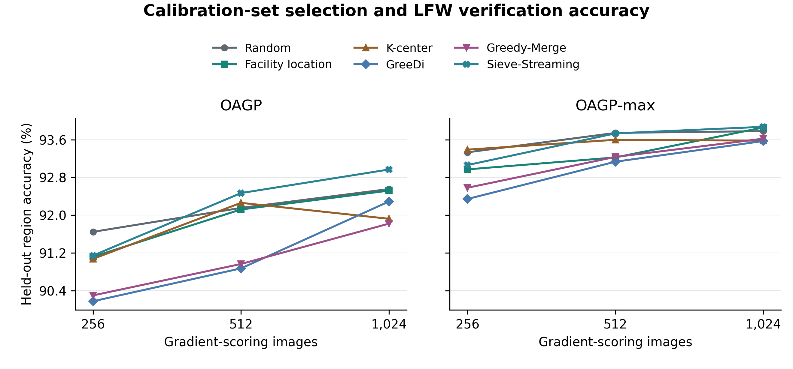

# Does calibration photo selection improve occlusion-aware pruning?

With 1,024 CASIA training photos, Sieve-Streaming gave the highest four-region LFW verification accuracy among the six selectors for both OAGP (**92.97%**) and OAGP-max (**93.87%**). Relative to uniform random selection, the gains were **0.41** and **0.09 percentage points**. Magnitude pruning reached **94.93%** at the same sparsity, and the unpruned Dense-Aug model reached **95.77%**. For a square covering 50% of the probe, OAGP-max with Sieve reached **89.51%** and magnitude reached **89.17%**. [One-shot controls](../one_shot_seed42/README.md)

## Paired comparison at 1,024 photos

Each LFW decision asks whether two photos show the same person. The primary metric gives equal weight to four held-out probe occlusions covering the eyes, mouth/nose, upper half and lower half. For example, random OAGP-max at **93.78%** correctly classified 67,522 of 72,000 decisions across 6,000 pairs, four occlusions and three calibration seeds. The same pairs occur in every condition and seed.

| Calibration selector | OAGP (%) | Δ from random (pp) | OAGP-max (%) | Δ from random (pp) |
| --- | ---: | ---: | ---: | ---: |
| Random | 92.55 | — | 93.78 | — |
| Facility location | 92.52 | −0.03 ± 0.36 | 93.86 | +0.08 ± 0.13 |
| Farthest-first k-center | 91.92 | −0.63 ± 0.55 | 93.58 | −0.20 ± 0.31 |
| GreeDi | 92.29 | −0.26 ± 0.32 | 93.57 | −0.21 ± 0.07 |
| Greedy-Merge | 91.82 | −0.73 ± 0.19 | 93.62 | −0.16 ± 0.23 |
| Sieve-Streaming | **92.97** | **+0.41 ± 0.29** | **93.87** | **+0.09 ± 0.08** |

Accuracy columns average the three scoring seeds (42, 43, 44). Deltas are the mean and sample standard deviation of the three within-seed differences, in percentage points. At 256 photos, random had the highest OAGP mean and k-center had the highest OAGP-max mean. At 512 photos, Sieve led OAGP and random led OAGP-max. All seed-level measurements, including square occlusions and individual regions, are available in the [accuracy table](paired_seed_metrics.csv).



## What changed between runs

- **Photos.** The candidate pool contains 3,071 distinct training photos covering 2,318 CASIA identities. It is the union of the three original random draws of 1,024 photos. For each seed, all selectors share a first photo. Selected photos alternate clean and square-occluded views. At a given seed and budget, every selector uses the same square coordinates. The 256- and 512-photo random selections are prefixes of their original draw.
- **Selectors.** Full-pool facility location uses centralized lazy greedy to maximize average nearest-representative similarity. On this pool, ordinary greedy and exact two-shard maximum reduction reproduced all 1,023 post-anchor choices at all three seeds. K-center uses the farthest photo from the existing centers. GreeDi builds a candidate list on each of two shards and selects from their union. Greedy-Merge takes half the budget from each shard. Sieve-Streaming visits candidates in seed order with ε = 0.2. All nine Sieve sets filled their budget. This implementation precomputes the full similarity matrix. [Selector code](../../../src/occprune/calibration_selection.py) · [Sieve implementation](../../../src/occprune/_sieve_selection.py)
- **Pruning.** All 108 configurations use the same Dense-Aug ResNet-18 training checkpoint. For each selection, both pruning methods share one backward pass per photo. OAGP averages the layer-normalized clean and occluded Taylor scores with α = 0.5. OAGP-max keeps the larger score for each weight. Both retain 5,578,752 of 11,157,504 eligible weights by pruning 50% in each of 19 non-stem convolution layers. Fine-tuning is zero steps. [Protocol and hashes](protocol.json)
- **Evaluation.** Each test condition uses the same 3,000 matched and 3,000 unmatched LFW pairs. The gallery is clean and only the probe receives an occlusion. The threshold for each fold is fit using the other nine folds. Training used 10–30% area squares. A 50% square also participated in CASIA checkpoint validation. The four fixed facial regions provide the held-out geometry comparison.

The selectors were explored after seeing earlier LFW results. All methods share one candidate pool, one trained checkpoint and one sparsity. The three seeds measure calibration variability under these choices. The timing table records embedding, kernel construction, selection, shared scoring, per-method aggregation, masking and evaluation. The shared stages appear on multiple rows. Random selection time measures replaying saved indices. [Geometry and wall times](coverage_and_timing.csv)

## Reproduce the comparison

Run the following from the repository root with NumPy installed. It checks the five public artifact hashes, refits every fold threshold from the saved scores, checks 8,640 held-out fold counts, and verifies all 1,080 accuracy rows and their paired differences.

```bash
python scripts/verify_calibration_selection.py
```

The [pair score archive](pair_similarities.npz) stores the condition order, the ten fold counts per condition and method setting, and cosine scores for 102 settings. The six random settings at 1,024 photos reuse the [one-shot archive](../one_shot_seed42/pair_similarities.npz), which also supplies pair labels, folds and the dense and magnitude controls. [Selection orders](selection_orders.npz) record training-row positions and calibration square coordinates. Use the [notebook](../../../notebooks/04_calibration_selection.ipynb) to inspect the tables or rerun pruning with the original checkpoint and data.
