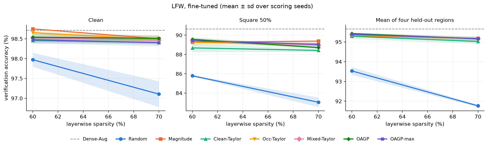

# Pruning followed by one epoch of fine-tuning (E3)

One epoch of fine-tuning on CASIA (lr 0.01, cosine to 0, masks re-applied after every step) **closed almost the whole gap**.
At 60% and 70% sparsity every method except Random recovered to **95.0–95.4%** four-region LFW accuracy, within 0.5 pp of
the unpruned Dense-Aug model (95.66%). Gradient methods that had collapsed to about 55% one-shot recovered fully. The
data used for scoring still had a small, consistent effect: **Occ-Taylor beat Clean-Taylor by +0.17 pp (60%) and +0.21 pp (70%)**,
with 14 of 48 seed × condition CIs above zero and none below. Magnitude, Occ-Taylor, OAGP and OAGP-max were
indistinguishable (mean differences within ±0.06 pp, significant cells in both directions).

## Four-region LFW mean (%), mean ± sd over scoring seeds 42–44

| Method | 60% one-shot | 60% fine-tuned | 70% one-shot | 70% fine-tuned |
| --- | ---: | ---: | ---: | ---: |
| Dense-Aug (unpruned) | 95.66 | | | |
| Random | 54.87 | 93.53 ± 0.19 | 54.08 | 91.77 ± 0.06 |
| Magnitude | 93.21 | 95.31 | 86.68 | 95.18 |
| Clean-Taylor | 66.63 | 95.29 ± 0.13 | 54.19 | 95.02 ± 0.12 |
| Occ-Taylor | 79.25 | 95.33 ± 0.07 | 59.47 | 95.18 ± 0.06 |
| Mixed-Taylor | 74.49 | 95.37 ± 0.08 | 55.40 | 95.17 ± 0.10 |
| OAGP (α = 0.5) | 73.25 | **95.43 ± 0.05** | 55.63 | 95.16 ± 0.11 |
| OAGP-max | 78.79 | 95.39 ± 0.06 | 56.44 | 95.17 ± 0.02 |

All conditions are in [summary_lfw_fine_tuned.md](summary_lfw_fine_tuned.md) (the one-shot columns repeat the
[one-shot grid](../oneshot_grid/README.md)); held-out CASIA pairs are in
[summary_validation_fine_tuned.md](summary_validation_fine_tuned.md).



## Paired contrasts after fine-tuning (B − A, pp; cells with CI > 0 / < 0 out of 24)

| A → B | 60% | 70% |
| --- | --- | --- |
| Clean-Taylor → Occ-Taylor | +0.17 (9+, 0−) | +0.21 (5+, 0−) |
| OAGP → OAGP-max | −0.06 (1+, 3−) | +0.06 (2+, 2−) |
| Magnitude → OAGP-max | +0.05 (2+, 3−) | −0.04 (1+, 1−) |
| Magnitude → Occ-Taylor | +0.04 (2+, 0−) | −0.03 (1+, 0−) |

The significant Occ-Taylor gains are mostly on the 50% square and the upper / lower half regions. Per-pair CIs are in
[bootstrap_lfw.csv](bootstrap_lfw.csv).

## Setup and limits

- Sparsities 60% and 70% were chosen on held-out CASIA pairs (seed 42) as the range where one-shot accuracy drops sharply,
  before looking at LFW.
- Fine-tuning: one epoch over all 481,210 CASIA training photos (1,879 steps of 256), SGD with the dense recipe's momentum and weight
  decay, its own lr 0.01 with per-step cosine decay to 0 and no warm-up, the same 10–30% square augmentation as Dense-Aug.
  It takes about 2 minutes per method and sparsity on an RTX 3070 Ti Laptop GPU, so a seed takes about 36 minutes.
- The fine-tuning seed is fixed (42) and only the scoring seed varies, so Magnitude's three runs are identical (sd 0) and
  the reported spread does not include fine-tuning noise. Differences of about 0.1 pp between methods should be read with
  this in mind.

```bash
python -m occprune.prune_run --checkpoint checkpoints/dense_aug_seed42.pt \
    --output results/pruning/runs/finetune_grid_score42 --sparsity 0.6 0.7 --scoring-seed 42 \
    --ft-epochs 1 --test-set lfw --no-save-banks
```

```python
from occprune.prune_report import write_grid_report
write_grid_report([f"results/pruning/runs/finetune_grid_score{s}" for s in (42, 43, 44)], "results/pruning/finetune_grid")
```
