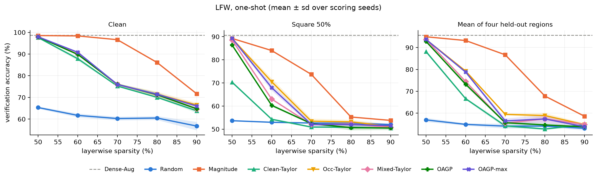
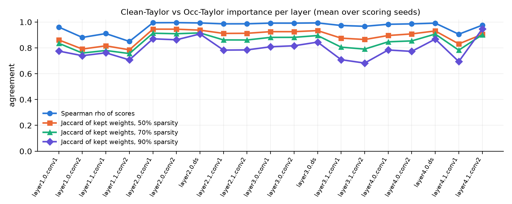

# One-shot pruning across sparsity: seven methods, three scoring seeds (E2, E3, E4, E5, E7)

Without fine-tuning, **magnitude pruning was the most robust method at every sparsity**. At 60% layerwise sparsity it kept a
four-region LFW mean of **93.21%**, while the best gradient method (Occ-Taylor) fell to **79.25%**. Among the gradient
methods, **the data used to estimate importance mattered a lot**: Occ-Taylor beat Clean-Taylor by **+6.2 / +11.5 / +4.8 / +4.5 pp**
at 50 / 60 / 70 / 80% (pair-level bootstrap CI above zero in 22–24 of 24 seed × condition cells each), and OAGP-max beat
α-weighted OAGP (+0.9 to +4.9 pp). Clean and occluded Taylor importance were highly but not perfectly aligned
(parameter-weighted Spearman **0.964**).

Re-estimating BatchNorm statistics after pruning, with no weight update, recovers most of the gradient methods' collapse but leaves this ranking intact; see the [BN recalibration grid](../bnrecal_grid/README.md).

## Four-region LFW mean (%), mean over scoring seeds 42–44

| Method | 50% | 60% | 70% | 80% | 90% |
| --- | ---: | ---: | ---: | ---: | ---: |
| Dense-Aug (unpruned) | 95.66 | | | | |
| Random | 56.93 | 54.87 | 54.08 | 54.11 | 53.05 |
| Magnitude | **94.93** | **93.21** | **86.68** | **67.83** | **58.58** |
| Clean-Taylor | 88.19 | 66.63 | 54.19 | 52.75 | 54.69 |
| Occ-Taylor | 93.73 | 79.25 | 59.47 | 58.91 | 54.80 |
| Mixed-Taylor | 93.71 | 74.49 | 55.40 | 57.42 | 54.80 |
| OAGP (α = 0.5) | 92.82 | 73.25 | 55.63 | 54.63 | 53.73 |
| OAGP-max | 93.76 | 78.79 | 56.44 | 57.36 | 53.80 |

The region mean gives equal weight to eyes, mouth + nose, upper half and lower half, none of which were seen in training.
Clean, square 10/30/50% and each region, with seed standard deviations, are in
[summary_lfw_one_shot.md](summary_lfw_one_shot.md); the same table on held-out CASIA pairs is
[summary_validation_one_shot.md](summary_validation_one_shot.md). Magnitude does not depend on the scoring seed, so its
three runs are identical.



## Paired contrasts (B − A, percentage points)

Each run is compared on the same 6,000 LFW pairs; [bootstrap_lfw.csv](bootstrap_lfw.csv) holds the 95% CI from resampling
pairs for every seed, sparsity and condition. "Cells" counts the 24 seed × condition comparisons (3 seeds × 8 conditions)
whose CI lies above (+) or below (−) zero.

| A → B | 50% | 60% | 70% | 80% | 90% |
| --- | --- | --- | --- | --- | --- |
| Clean-Taylor → Occ-Taylor | +6.20 (23+) | +11.46 (24+) | +4.81 (22+) | +4.53 (22+) | +0.71 (8+, 3−) |
| OAGP → OAGP-max | +0.94 (17+) | +4.86 (23+) | +0.64 (9+, 2−) | +2.14 (17+) | +0.40 (7+, 1−) |
| Magnitude → OAGP-max | −0.88 (18−) | −12.83 (24−) | −27.49 (24−) | −11.19 (24−) | −5.74 (23−) |
| Magnitude → Occ-Taylor | −0.96 (18−) | −12.43 (24−) | −25.02 (24−) | −10.11 (23−) | −4.71 (23−) |

## Clean vs occluded importance (E4)

For each of the 19 pruned convolutions, [bank_agreement.csv](bank_agreement.csv) compares the Clean-Taylor and Occ-Taylor
scores of one seed: Spearman rank correlation, the ratio of mean occluded to mean clean score, and the Jaccard overlap of
the weights each criterion keeps. Weighted by layer size and averaged over seeds:

| Spearman ρ | Occluded / clean mean score | Kept-weight Jaccard at 50% | at 70% | at 90% |
| ---: | ---: | ---: | ---: | ---: |
| 0.964 | 1.72 | 0.887 | 0.846 | 0.792 |

Per layer, ρ ranges from 0.85 (layer1.1.conv2) to 0.995 (layer2.0.conv2), and occluded inputs produce about 2× larger
scores in layer1 and about 1.7× elsewhere. The two criteria agree on most weights, and they disagree more on the weights
that decide high-sparsity masks.



## Setup and reproduction

- All runs start from the [Dense-Aug checkpoint](../../../README.md#trained-models) (ResNet-18 + CosFace, seed 42). Layerwise
  unstructured pruning of the 19 non-stem convolutions (11,157,504 weights). Stem, embedding layer and head are kept.
  Zero fine-tuning steps.
- Calibration: B = 1,024 CASIA training photos split into halves A and B, giving four per-example Taylor banks (clean / occluded × A / B,
  2,048 backward passes, under a minute in total on an RTX 3070 Ti Laptop GPU). Clean-Taylor = clean A + clean B, Occ-Taylor =
  occluded A + occluded B; Mixed-Taylor, OAGP and OAGP-max all use clean A + occluded B. Only the scoring seed changes
  between the three repeats.
- Evaluation: LFW 10-fold verification, clean gallery, occluded probe, fixed occlusions from `results/masks/`. Run on CUDA;
  Dense-Aug reaches 95.66% here versus 95.77% in the [earlier MPS run](../one_shot_seed42/README.md).

```bash
# from the repository root, with src on PYTHONPATH; about 10–20 min per seed
python -m occprune.prune_run --checkpoint checkpoints/dense_aug_seed42.pt \
    --output results/pruning/runs/oneshot_grid_score42 --sparsity 0.5 0.6 0.7 0.8 0.9 --scoring-seed 42 --test-set lfw
```

```python
from occprune.prune_report import write_grid_report     # rebuilds every file in this folder
write_grid_report([f"results/pruning/runs/oneshot_grid_score{s}" for s in (42, 43, 44)], "results/pruning/oneshot_grid")
```

The per-run `result.json` and `pair_similarities.npz` are in `results/pruning/runs/oneshot_grid_score*/`; the score banks
(`condition_scores.npz`) and masks are git-ignored and must be regenerated locally for `bank_agreement`.
